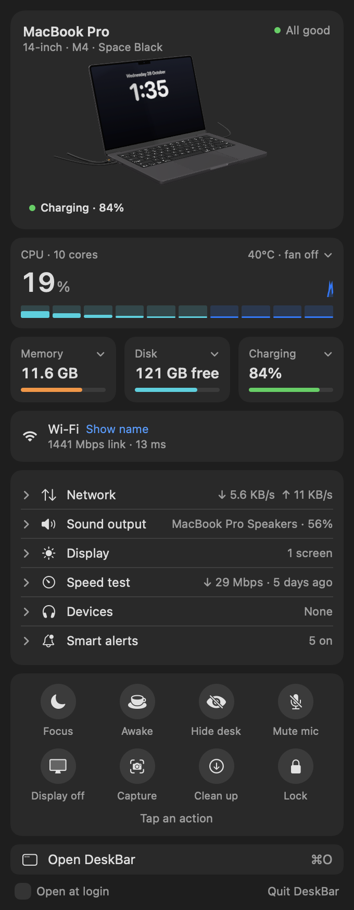
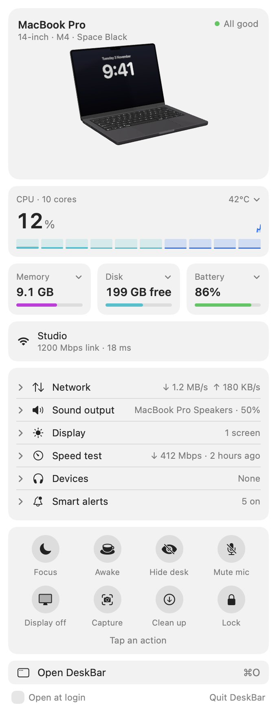
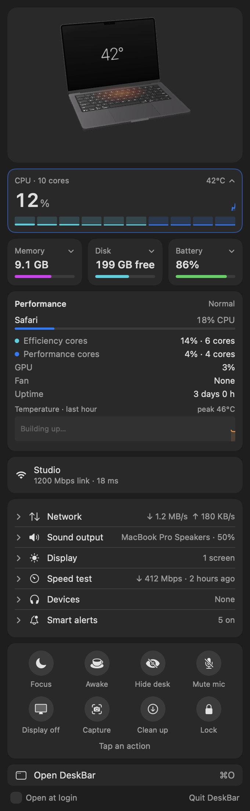
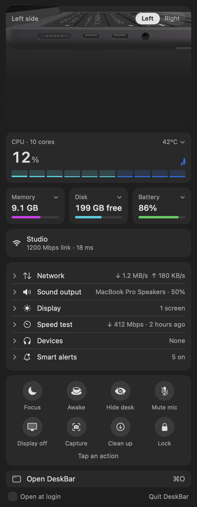
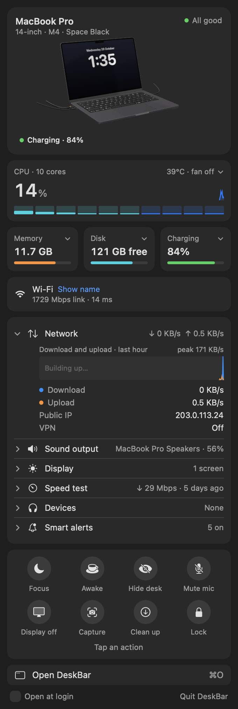
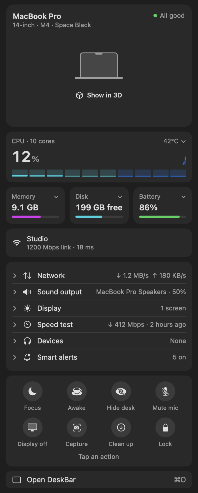

# DeskBar

**Your Mac, at a glance, in the menu bar.** One click shows how your Mac is doing (heat, memory,
disk, battery, network, what's plugged in), and a living 3D model of your MacBook reflects it.
The lid follows your real lid, a MagSafe cable appears when you plug in, and your monitors
appear when you connect them.

<p align="center">
  
  &nbsp;
  
</p>

## Why

The Mac hides its vital signs in four places: Activity Monitor, System Settings, Control Centre and
the battery menu. Most menu bar monitors fix that by adding more numbers. DeskBar takes the opposite
approach:

- **One glance answers "is everything OK?"** The top card says *All good*, or names the one thing
  that isn't: *Running hot*, *Memory full*, *Disk almost full*, *Offline*.
- **Detail only when you ask.** Every tile opens in place: per-core CPU, memory pressure, the apps
  using it, battery health.
- **Things you'd otherwise dig for, one click away.** Focus, Keep awake, Hide desktop, Mute mic,
  Display off, Screenshot, Clean up Downloads, Lock.

## What's in the panel

| | |
|---|---|
| **Living Mac** | 3D MacBook that mirrors the real one: lid angle, charging, MagSafe, AirPods, camera and microphone in use. Zooms into the ports to show what's plugged into each, and switches to a desk view with your external monitors. |
| **CPU** | Efficiency and performance cores, GPU, temperature, fan, uptime, and a short history. |
| **Memory · Disk · Battery** | Memory pressure, free space and Downloads cleanup, power draw, charger wattage, battery health and cycles. |
| **Wi-Fi & network** | Link speed, latency, live throughput, public IP, VPN. |
| **Sound & display** | Output device and volume. External monitor brightness over DDC, and Night Shift. |
| **Speed test** | Runs macOS's own `networkQuality` and keeps your last ten results. |
| **Devices** | Bluetooth battery levels, and what's using the camera or microphone. |
| **Smart alerts** | Notifies you when memory is full, the Mac starts throttling, the battery or disk runs low, or your headphones or mouse need charging. |
| **Window** | *Open DeskBar* (⌘O) opens a full window with history charts for CPU, memory, storage, battery, displays and network. |

<p align="center">
  
  
  
</p>

## Install

DeskBar is a Swift package with no dependencies. You need **macOS 15 or later on Apple silicon**. It
was built and tested on macOS 26 with an M4 MacBook Pro.

```bash
git clone https://github.com/<you>/DeskBar.git
cd DeskBar
./build.sh
open DeskBar.app
```

`build.sh` builds a release binary, wraps it in `DeskBar.app` and signs it ad hoc so it runs on your
own Mac.

### The 3D Mac

The 3D MacBook Pro is Apple's own model, the one behind *View in AR* on apple.com. It isn't this
project's to redistribute, so it isn't in this repository. On first launch the panel shows a flat
MacBook with a **Show in 3D** button. Clicking it downloads the model (10 MB) from apple.com into
`~/Library/Application Support/DeskBar/`. If you'd rather bundle it in your own build, put the file in
`Models/macbook-pro-14-space-black.usdz` before running `build.sh`.

<p align="center"></p>

## Privacy

Everything DeskBar shows is read on your Mac and stays on your Mac. There's no account, no
analytics and no tracking. It only goes online for these:

| What | Where | When |
|---|---|---|
| Latency | `ping` to 1.1.1.1 | every 10 s |
| Public IP | api.ipify.org | every 10 minutes, or when you change network |
| Speed test | Apple's `networkQuality` servers | only when you run one |
| 3D model | apple.com | only when you click *Show in 3D* |

macOS will ask for permissions as you use features:
- **Location:** only so macOS will reveal your Wi-Fi network's name.
- **Bluetooth:** for device battery levels.
- **Notifications:** for smart alerts.

## Performance

A menu bar app should be invisible until you look at it. Rendering stops whenever the panel and
window are closed. Idle CPU sits around 0–1.5%, and the 3D view renders only while it's on screen.

Every change is checked against a long-running build. That's how a slow leak in macOS's segmented
control was found and designed out: it had pushed CPU to 50–100% after three days. The full story
is in [docs/PRODUCT.md](docs/PRODUCT.md#case-study-the-four-day-glitch).

## Development

```bash
swift build                                              # debug build
./DeskBar.app/Contents/MacOS/DeskBar --snapshot out/     # renders the panel to PNGs, light and dark
DESKBAR_DEMO=1 ./DeskBar.app/Contents/MacOS/DeskBar --snapshot docs/images   # shareable screenshots
DESKBAR_DEMO=1 ./DeskBar.app/Contents/MacOS/DeskBar --snapshot out/ --demo-video --fonts <dir> [--credit "Built by …"]   # the 43-second demo video; <dir> holds EB Garamond (OFL)
```

`--snapshot` modes render the real views offscreen. That's how every screenshot here was made, and
how visual changes are checked without clicking through the app. `DESKBAR_DEMO=1` swaps in a
placeholder IP address and a generic Mac name.

See [CONTRIBUTING.md](CONTRIBUTING.md) and the product thinking behind it in
[docs/PRODUCT.md](docs/PRODUCT.md).

## Licence

MIT. See [LICENSE](LICENSE). Apple, MacBook Pro, MagSafe and AirPods are trademarks of Apple Inc.
DeskBar is an independent project and isn't affiliated with Apple.
